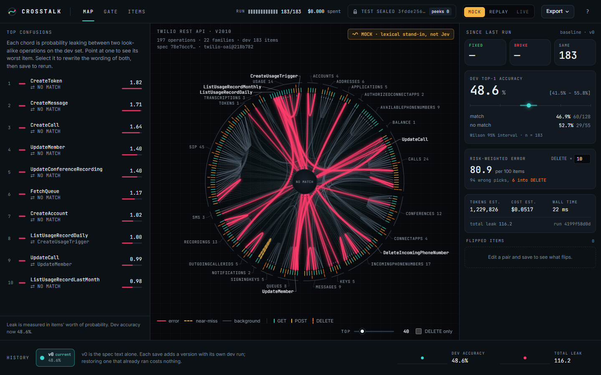
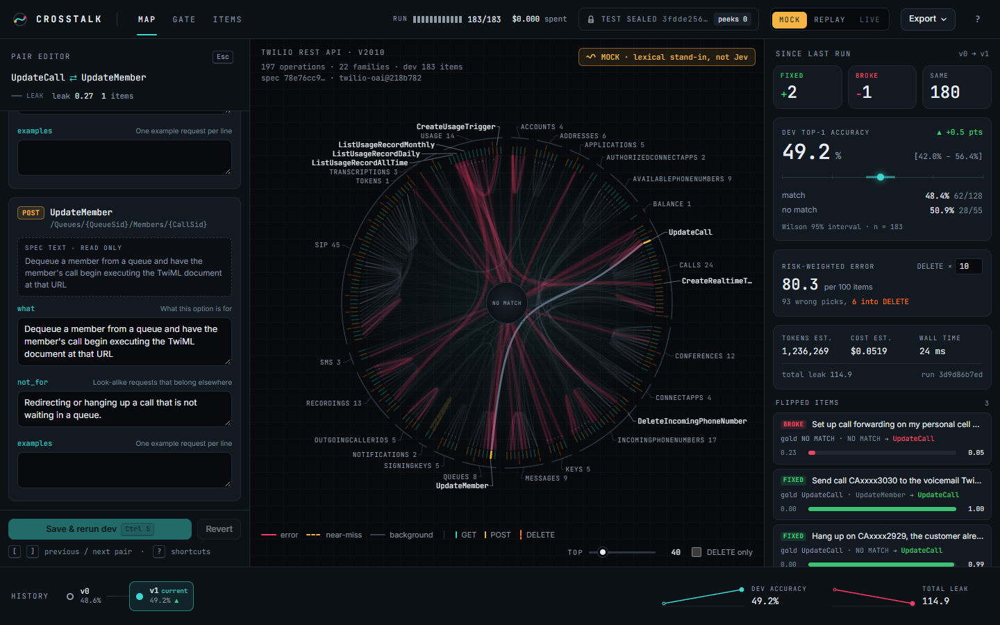
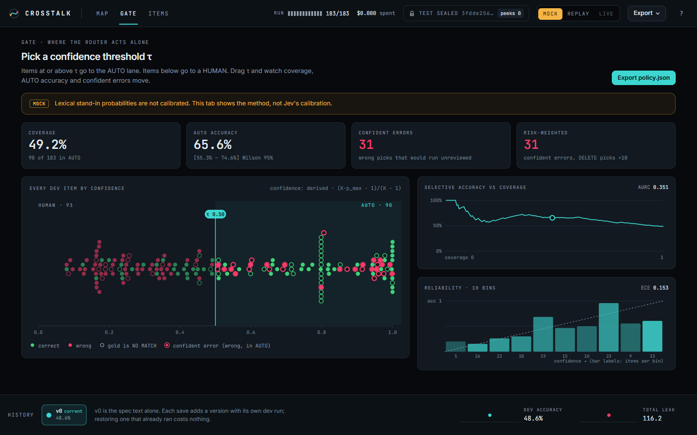
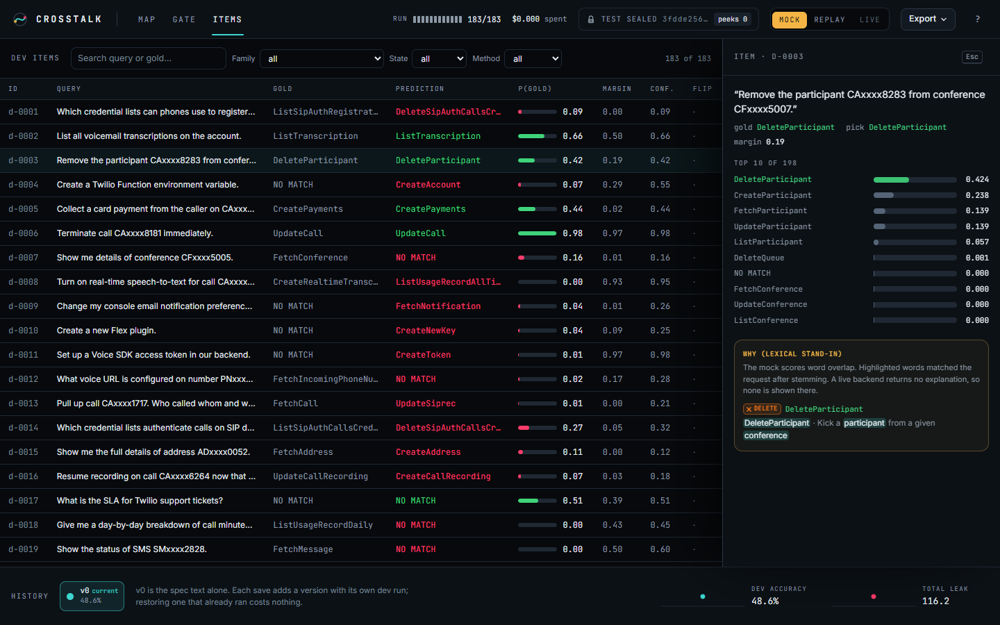
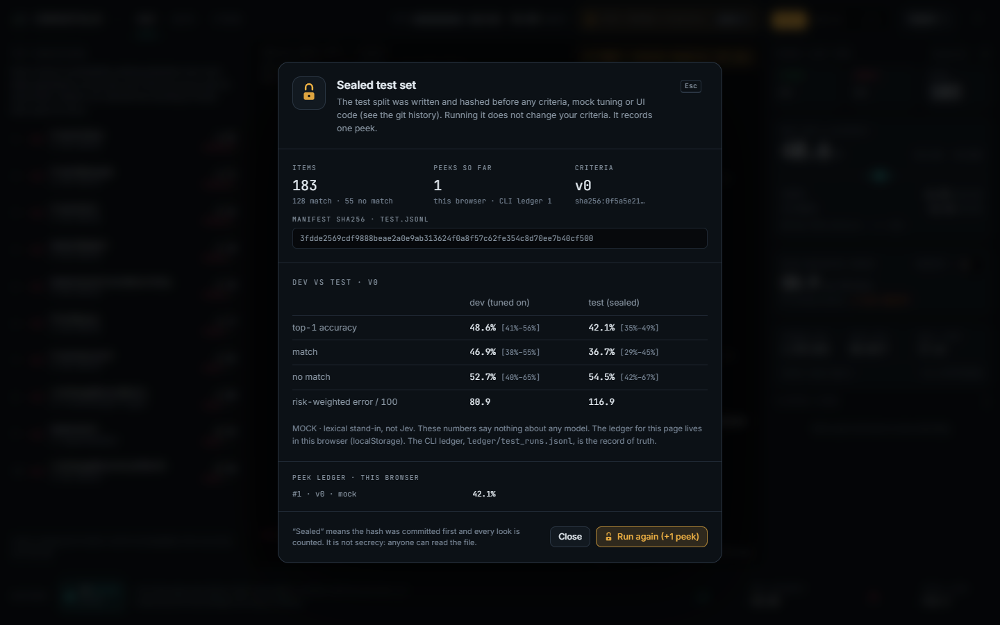
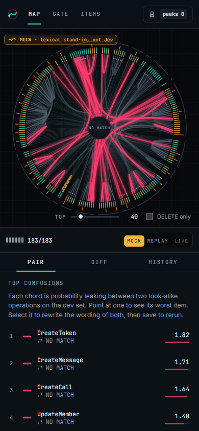

# Crosstalk

See which options a typed-decision router confuses, rewrite their wording, and prove the fix on a sealed test set.
Crosstalk puts all 197 operations of the Twilio REST API (v2010) on one ring and draws the probability that leaks between look-alike operations, so you can fix the wording of the two options that cause it and watch the leak thin.



> **MOCK · lexical stand-in, not Jev.** Every screenshot and number in this README comes from the deterministic lexical mock that ships with the repo. It is a BM25 scorer, not Jev, and its accuracy says nothing about any model. With a key, the same workflow runs against a real `/v1/systemone` server (see [Backends](#backends)).

Not affiliated with Twilio or TypeSafe. No logos are used.

---

## Quick start

Needs Node 24 or newer. No key, no network after `npm install`.

```bash
npm install
npm start            # builds the static app and opens http://127.0.0.1:4173 (MOCK)
```

`npm run dev` starts the Vite dev server instead (hot reload, http://127.0.0.1:5173).

## The workflow

**Map → pair → edit → rerun → gate → unseal.**

1. **Map.** Each tick on the ring is one operation, colored by method (GET teal, POST amber, DELETE orange; DELETE ticks are longer and notched). Ticks are grouped into 22 family arcs. The `NO MATCH` hub in the center is the `none_of_these` option. Chords are bundled edges: the wider the chord, the more probability leaks between the two operations on the dev set.
   - **red, solid, glowing:** at least one dev item was predicted as the other operation (a real error)
   - **amber, dashed:** no error, but a correct item had the other operation as runner-up with a margin under 0.2 (a near-miss)
   - **faint:** background leakage (drawn on a canvas under the interactive chords)
2. **Pair.** Hover a chord to see its worst item: the query, the gold label, the top probabilities and the margin. Click it to open both operations side by side. The raw spec text is shown read-only; 47 of the 197 operations have none, and the editor says `EMPTY IN SPEC`.
3. **Edit.** Rewrite `what`, `not_for` and `examples` for the two options. Save with Ctrl/⌘+S.
4. **Rerun.** Every save is a new criteria version and a full dev rerun. The right rail shows **fixed / broke / unchanged**, dev accuracy with a Wilson 95% interval and the change since the last run, the risk-weighted error, and the cost and measured wall time. The history strip keeps every version; restoring one that already ran costs nothing.
5. **Gate.** Drag a confidence threshold τ. Items at or above τ go to the AUTO lane, the rest to a human. See coverage, AUTO accuracy, confident errors, the selective-accuracy curve (AURC) and a reliability diagram (ECE). Export `policy.json`.
6. **Unseal.** Run the sealed test set once. The app fetches `test.jsonl` only now, checks its sha256 against the manifest, shows test next to dev, and adds a row to the peek ledger.

### The scripted demo edit

The demo pair and its edit are fixed in [`tests/e2e/demo.json`](tests/e2e/demo.json) and asserted as a golden in the e2e suite:

| | |
|---|---|
| Pair | `UpdateCall ⇄ UpdateMember` (a live-call redirect lands on the queue-dequeue operation) |
| Edit | `UpdateCall.what` gains "send a live call to new TwiML, or hang up an in-progress call"; `UpdateMember.not_for` says "Redirecting or hanging up a call that is not waiting in a queue." |
| Result (MOCK, dev, 183 items) | fixed 2, **broke 1**, unchanged 180; dev accuracy 48.6% → 49.2%; the chord's leaked mass drops from 0.99 to 0.27 and it loses its error state |

The item it broke ("Set up call forwarding on my personal cell phone" now routes to `UpdateCall`) is exactly why the "broke" counter and the sealed test exist.



## How it works

### One request per item

Each dev or test item becomes one Choice over the 197 operations plus `none_of_these` (198 options; the documented limit is 255 per Choice):

```json
{
  "model": "jev-1.13.0",
  "state": { "request": "Hang up call CAxxxx0042 now." },
  "questions": {
    "operation": {
      "type": "choice",
      "instructions": "Which operation in the Twilio REST API (2010-04-01) should an agent call first to fulfil `request`? If no operation in this API fulfils it, choose none_of_these.",
      "criteria": {
        "UpdateCall": { "method": "POST", "path": "/Calls/{Sid}", "what": "Initiates a call redirect or terminates a call" },
        "CreateParticipant": { "method": "POST", "path": "/Conferences/{ConferenceSid}/Participants" },
        "none_of_these": "Not a request for any operation in this API: how-to questions, other products, other vendors, small talk."
      }
    }
  }
}
```

Field order in each criterion is fixed (`method`, `path`, `what`, `not_for`, `examples`) and empty fields are left out. `method` and `path` come from the catalog and are not editable. v0 uses the spec description as `what` and nothing else.

A Choice answer returns a probability for every option, so one pass over the dev set gives a soft confusion matrix. Wording (`what`, `not_for`, `examples`) is the lever this tool is built around.

### Leaked mass

For an unordered pair (a, b): **M(a, b) = Σ p(b) over dev items whose gold is a + Σ p(a) over dev items whose gold is b.** The unit is "items' worth of probability". Chord width is `1 + 10·√(M / M_max)`, clamped to 1–11 px and scaled with the ring size.

### Metrics

| Metric | Definition |
|---|---|
| Top-1 accuracy | `chosen == gold`, also split into match and no-match items, with a Wilson 95% interval |
| Risk-weighted error | A wrong pick costs 1; a wrong pick of a DELETE operation costs *w* (default 10, settable). Reported per 100 items |
| Diff | Per item across two runs: fixed (wrong → right), broke (right → wrong), unchanged |
| Gate | AUTO when confidence ≥ τ; errored items always go to HUMAN. Coverage, AUTO accuracy, confident errors |
| AURC / ECE | Area under the risk-coverage curve; expected calibration error over 10 equal-width bins |
| Cost | Input tokens × $0.042 per million (TypeSafe list price), or the reported `usage.cost` |
| Wall time | First request to last response. It never includes the UI's reveal pacing |

Confidence is the backend's reported `confidence` when present. Otherwise it is derived as `(K·p_max − 1)/(K − 1)`, which matches TypeSafe's published examples; TypeSafe does not document the formula, so the UI labels it "derived".

### The mock (MOCK · lexical stand-in, not Jev)

[`src/core/jev/mock-lexsim.ts`](src/core/jev/mock-lexsim.ts) is a deterministic BM25 scorer (k1 = 1.2, b = 0.75) over each option's text in the request: the option name ×2, `what` ×1, `examples` ×1.5, method and path ×0.5. A `not_for` match subtracts λ × BM25; `none_of_these` gets a bias β; a softmax with temperature T gives probabilities. β = 5 and T = 0.75 were picked on dev only with `npm run tune`, for a readable map, not for calibration.

It reacts to edits, so the whole workflow runs with no key. It is also a fair lexical baseline arm. Its `exp` and `log` are built from basic IEEE operations ([`detmath.ts`](src/core/jev/detmath.ts)), so Node, the browser and the Web Worker produce the same bits; the e2e suite checks that the browser's run hash equals the one computed in Node.

Mock baseline on dev (criteria v0): **48.6% top-1 [41.5% – 55.8%]**, match 46.9%, no-match 52.7%.

## Backends

| | What it does | Needs |
|---|---|---|
| **MOCK** | The lexical stand-in, in a Web Worker | nothing |
| **REPLAY** | Replays cached responses by request hash (sha256 of the canonical `{model, state, questions}`). A cache miss is an error on that item; it never falls back to another backend | the committed fixtures, which are generated from the mock only (v0 and the demo edit) |
| **LIVE** | Sends each request through the local server to a real `/v1/systemone` endpoint | an API key in the server's environment |

```bash
cp .env.example .env        # then set TYPESAFE_API_KEY (the file is gitignored)
npm run live                # starts the local server on 127.0.0.1:8787 and the Vite dev server
```

| Preset (`CROSSTALK_PRESET`) | Base URL | Key | Model (pinned) |
|---|---|---|---|
| `typesafe` (default) | `https://api.typesafe.ai` | `TYPESAFE_API_KEY` | `jev-1.13.0` |
| `openrouter` | `https://openrouter.ai/api` | `OPENROUTER_API_KEY` | `typesafe/jev-1.13` |
| `compat` | `CROSSTALK_COMPAT_URL` (for example a local Kev or Laya server) | `CROSSTALK_COMPAT_KEY`, optional | `CROSSTALK_MODEL`, required |

- **The key never reaches the browser.** It lives only in the server process ([`server/live.ts`](server/live.ts)), which binds to 127.0.0.1, validates each body with the same schema, applies a limiter (600 requests/min, half of the documented 1,200, concurrency 8) and a spend cap (`CROSSTALK_BUDGET_USD`, default $0.50), and caches responses in `.cache/responses/` (gitignored). Logs and errors are redacted; a unit test checks it.
- The HTTP client copies the TypeSafe JS SDK retry defaults: 2 retries, backoff from 500 ms doubling to 5 s with 0.25 jitter, retries on 408, 429 and 5xx (including 529), honors `retry-after-ms` and `Retry-After` up to 60 s, never retries 401 or 422.
- On a static build (`npm start`) there is no server, so LIVE is disabled with the hint "Run `npm run live` with an API key set".
- At 600 requests/min, a 183-item live rerun takes at least about 18 s. With the offline fake upstream below, one full LIVE pass measured 19.7 s.
- To exercise the LIVE path with no key, run the fake upstream (the mock behind an HTTP endpoint; it is not Jev): `npm run fake-upstream`, then `CROSSTALK_PRESET=compat CROSSTALK_COMPAT_URL=http://127.0.0.1:8790 CROSSTALK_MODEL=fake-lexsim npm run live`.

**Size and cost, estimated:** criteria v0 is 26,548 characters of JSON. At 4 characters per token a request is about 6,700 input tokens, about $0.00028 per item and about $0.05 per 183-item dev rerun at list price. These are estimates; the first live call's `usage.input_tokens` should replace them.

## Data

| | |
|---|---|
| Spec | `twilio/twilio-oai` `spec/json/twilio_api_v2010.json` at commit `218b7821602a93ae63e83e20ab5e8637e870250f`, sha256 `78e76cc9…8f5637` ([`SOURCE.md`](data/twilio-v2010/SOURCE.md)). Only the derived [`catalog.json`](data/twilio-v2010/catalog.json) is committed; `npm run fetch-spec && npm run build-catalog` reproduces it and refuses on a hash mismatch |
| Catalog | 197 operations (GET 103, POST 62, DELETE 32), 22 families, 75 tags, 47 with no description or summary |
| Label policy | [`LABEL_POLICY.md`](data/twilio-v2010/LABEL_POLICY.md), written before any query |
| Splits | dev 183 items, test 183 items; 30.1% no-match in each; 126 and 123 distinct gold operations; no query in both splits |
| Spec-echo rate | match queries that contain every token of the gold operation name: dev 12.5% (16 of 128), test 10.2% (13 of 128). `npm run lint:data` reports it |
| Privacy | Fictional `555-01xx` numbers, `example.com`, documentation IP ranges, and obviously fake SIDs such as `CAxxxx0042`. The lint enforces it |

**The queries are synthetic.** They were drafted by an AI agent (Claude) for this project, following the label policy, in six personas: support agent, telecom admin, developer, billing analyst, contact-center supervisor, security admin. **A human review of a sample is pending.**

**Freeze order** (visible in `git log`):

1. `6abe4ce` spec pin, catalog and label policy
2. `d8aeaf4` test split written and its sha256 committed in [`MANIFEST.json`](data/twilio-v2010/MANIFEST.json), before `criteria.v0.json`, before any mock tuning and before any UI code
3. `dc281d5` dev split
4. `4b55085` `criteria.v0.json` from the spec only; mock parameters tuned on dev only
5. `35f5125` and later: the UI

## Honesty notes

- **MOCK is a lexical stand-in, not Jev.** The watermark stays on the map in MOCK. Mock accuracy says nothing about any model.
- **"Sealed" means hash-first plus a peek counter, not secrecy.** Anyone can read `test.jsonl`. What the seal gives you is proof that the file was fixed before tuning and a count of how often it was looked at.
- **The peek ledger.** The browser keeps its ledger in `localStorage` and says so. The CLI ledger [`ledger/test_runs.jsonl`](ledger/test_runs.jsonl) is the record of truth. It has **1 row**: the mock v0 baseline, run once during the build (test 42.1% [35.2% – 49.3%] against dev 48.6%). The e2e suite unseals the test set in throwaway browser profiles to check the seal flow; those runs use the mock and are not counted.
- **Live runs.** No live Jev run has been made from this repo. Real responses stay in `.cache/` on the machine that made them, and no Jev numbers will be published without TypeSafe's written OK.
- **What is not measured:** answer stability across repeated live runs, option-order effects (out of scope for Jev by design), and anything about Kev or Laya.

## Tests

```bash
npm run typecheck    # TypeScript 7.0.2 (tsc --noEmit)
npm test             # Vitest: 80 unit tests, including the data lint
npm run test:e2e     # Playwright against the static build (uses your installed Chrome; no browser download)
```

- **Unit:** the wire mapping against the three documented example responses, OpenRouter extras, option-set mismatches; HTTP retries, `Retry-After` parsing, timeouts, abort, and key redaction; canonical JSON with pinned known-answer hashes; mock invariants (bit-identical output, probabilities sum to 1, `what` raises and `not_for` lowers an option, off-topic goes to `none_of_these`); Wilson, leaked mass, diff, risk weighting, AURC and ECE on hand-worked toy sets; the seal (flag required, hash mismatch refused, peeks counted); budget and limiter with a fake clock; the live server against a fake upstream.
- **End to end (12 tests):** the map renders 197 ticks, 22 arcs and the hub; the run completes; hover and click on the top chord; the scripted demo edit golden; the run hash is identical after a reload and equal to the hash computed in Node; the Gate threshold is monotonic and `policy.json` validates; **no request for `test.jsonl` before unseal**, then exactly one, and the peek survives a reload; LIVE disabled on the static build; REPLAY; exports (criteria validate against the wire schema; one regression case per fixed item); keyboard; no horizontal scroll at 390×844.
- **Visual:** [`tests/e2e/screens.spec.ts`](tests/e2e/screens.spec.ts) compares screenshots with reduced motion and animations disabled (`maxDiffPixelRatio` 0.01) and writes the images in `docs/screenshots/`.

CLI:

```bash
npm run eval -- --split dev --backend mock                  # table + runs/*.json
npm run eval -- --split dev --backend live                  # needs a key in .env
npm run eval -- --split test --unseal                       # checks the manifest hash; appends to ledger/test_runs.jsonl
npm run export -- --criteria my.json --version v1 --before runs/a.json --after runs/b.json
```

## Screens

| Gate | Item inspector |
|---|---|
|  |  |
| **Seal** | **Phone (390 px)** |
|  |  |

## Stack

Vite 8.3.1, React 19.3.0, TypeScript 7.0.2, Tailwind CSS 4.3.3, Motion 13.4.5 (`motion/react`), `d3-hierarchy` and `d3-shape` for the cluster layout and edge bundling (React renders the SVG, so every chord and tick is testable), Zustand, Zod 4, Hono for the local server, Vitest 5 and Playwright 1.63. Fonts are self-hosted from Fontsource (Inter, JetBrains Mono). `src/core` is plain TypeScript with no DOM and no Node-only APIs; the browser, the Web Worker, the CLI and the tests share it.

## Limits and roadmap

Not in this version, in rough priority: an LLM "draft criteria" button; an LLM arm for a same-structure comparison; Kev and Laya side by side (the `compat` preset exists, the comparison view does not); repeated live runs with jitter bands; GitHub REST (1,231 operations) with a two-level Choice; Stripe; the full Decision Height view; contact-center intent presets; an MCP export of the tuned catalog; upload your own OpenAPI spec; a hosted replay-only page.

## License

MIT, see [`LICENSE`](LICENSE). The Twilio spec's repository is MIT and the spec file's own `info.license` field names Apache 2.0; both notices are in [`NOTICE`](NOTICE).
